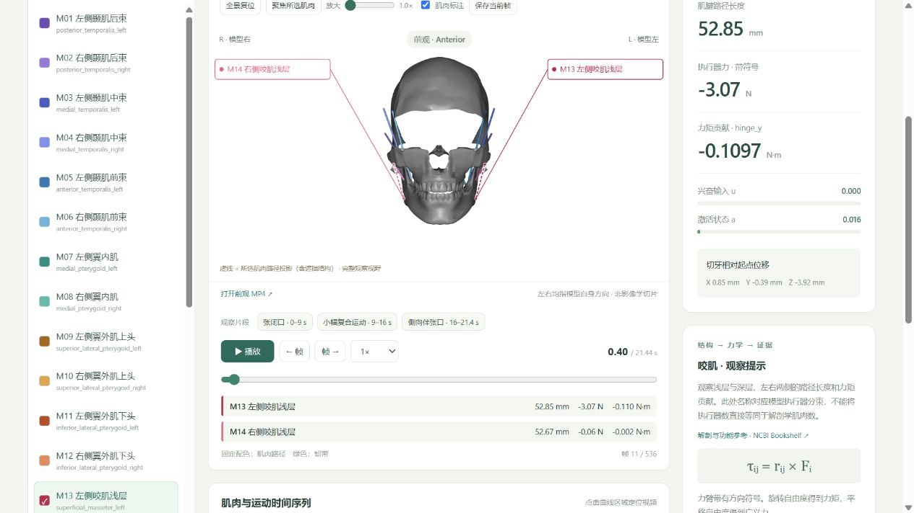

<div align="center">

# Hybrid Jaw Exo Sim · Replay Lab

**口颌肌骨多视角同步回放与教学数据查看器**

An anatomical multi-view replay and muscle-data explorer built on MuJoCo.

[**在线体验 / Live Demo**](https://minhhuyle597-ai.github.io/Hybrid-Jaw-Exo-Sim/) · [数据说明](docs/DATA.md) · [解剖展示规范](docs/ANATOMY.md) · [复现指南](docs/REPRODUCIBILITY.md)


</div>



> **本项目是仿真数据同步回放，不是在浏览器中实时求解物理。** 五个视频和肌肉数据来自同一份保存状态。它是基于 [Paul-Otto Müller / Hybrid Jaw Exo Sim](https://github.com/paulotto/hybrid-jaw-exo-sim/tree/v0.1.0) 的教学展示衍生项目，**不是上游官方仓库**。

## 项目目标

面向“AI 赋能口颌系统力学研究性学习”，把运动画面、肌肉路径、输入、长度、力和力矩放在同一时间轴中。使用者可以观察肌群协同，核对变量定义，再依据教材讨论模型假设，而不是把动画或 AI 解释直接当作力学证据。

## 功能

| 功能 | 当前实现 |
| --- | --- |
| 解剖视角 | 前观、后观、左侧观、右侧观、左前斜观；单视角显示，切换保留时间与播放状态 |
| 肌肉辨识 | 24 个执行器固定编号 M01–M24；视频路径、名称引线、筛选列表和曲线共用配色 |
| 动态标注 | 从逐帧肌腱路径和实际相机参数计算二维投影；虚线明确表示含遮挡结构的投影 |
| 局部观察 | 1–3× 放大、拖动平移、聚焦所选肌肉、全景复位、标注开关 |
| 播放 | 暂停、时间轴拖动、前后逐帧、0.25–2× 倍速、参考动作片段跳转 |
| 结构导航 | 按 M 编号、中文名和英文名搜索；按咀嚼肌、舌骨上肌群、下颌运动和力学边界筛选 |
| 教材证据 | 每个结构显示教材页码、证据等级、待核对结论、争议和模型边界 |
| 教学联动 | 点击张闭口、小幅复合运动或侧向伴张口时，同步跳转时间并选中相关肌肉 |
| 数据比较 | 同时比较 1–3 个肌肉，展开查看全部 24 个执行器 |
| 图表 | 兴奋输入、激活、肌腱路径长度、带符号力、力臂、力矩/广义力、切牙位移 |
| 导出 | 当前标注画面 PNG、各视角 MP4、逐帧 JSON、CSV、状态 NPZ |

## 教材联动与证据

项目在仿真回放之上增加了一层可核验的教学信息：

- 24 个肌肉执行器均已绑定《口腔解剖生理学》第 8 版的印刷页码。
- 五个模型自由度已标注《口腔生物力学》中的力学和颞下颌关节章节；这些自由度仍标记为模型假设，不冒充教材原文。
- 证据状态分为教材已核验、公开参考支持、存在分歧、模型教学假设和尚未核验。
- 翼外肌上头与关节盘的关系保留争议说明；执行器力、路径长度和牙齿咬合力之间的边界也明确标注。

### 快速体验

1. 打开 [在线 Demo](https://minhhuyle597-ai.github.io/Hybrid-Jaw-Exo-Sim/)，点击播放。
2. 搜索 `M13` 或“咬肌”，观察画面中的 **M13 / M14**、同色曲线和教材页码。
3. 暂停在任意时刻，再切换“后观”或“左侧观”，比较同一状态的不同观察方向。
4. 点击一个教学片段，检查时间、肌肉选择和教材问题是否同步变化。
5. 将指标切换为“力矩 / 广义力”，同时核对自由度说明、单位和力学来源。

## 视频与数据

所有视频均为 **1280 × 720 / H.264 / 25 FPS / 536 帧 / 21.44 秒**。最后记录点为 21.40 秒，最后一帧显示 0.04 秒。

| 资源 | 仓库路径 | 在线访问 |
| --- | --- | --- |
| 前观视频 | `public/videos/views/front.mp4` | [MP4](https://minhhuyle597-ai.github.io/Hybrid-Jaw-Exo-Sim/videos/views/front.mp4) |
| 后观视频 | `public/videos/views/back.mp4` | [MP4](https://minhhuyle597-ai.github.io/Hybrid-Jaw-Exo-Sim/videos/views/back.mp4) |
| 左/右侧观 | `public/videos/views/left.mp4` / `right.mp4` | [左侧](https://minhhuyle597-ai.github.io/Hybrid-Jaw-Exo-Sim/videos/views/left.mp4) · [右侧](https://minhhuyle597-ai.github.io/Hybrid-Jaw-Exo-Sim/videos/views/right.mp4) |
| 左前斜观 | `public/videos/views/oblique.mp4` | [MP4](https://minhhuyle597-ai.github.io/Hybrid-Jaw-Exo-Sim/videos/views/oblique.mp4) |
| 逐帧肌肉数据 | `public/data/frames.json` | [JSON](https://minhhuyle597-ai.github.io/Hybrid-Jaw-Exo-Sim/data/frames.json) |
| 肌肉长表 | `public/data/muscles.csv` | [CSV](https://minhhuyle597-ai.github.io/Hybrid-Jaw-Exo-Sim/data/muscles.csv) |
| 原始状态 | `public/data/states.npz` | [NPZ](https://minhhuyle597-ai.github.io/Hybrid-Jaw-Exo-Sim/data/states.npz) |
| 视角、配色、哈希 | `public/data/views.json` | [清单](https://minhhuyle597-ai.github.io/Hybrid-Jaw-Exo-Sim/data/views.json) |
| 来源及参数 | `public/data/provenance.json` | [来源记录](https://minhhuyle597-ai.github.io/Hybrid-Jaw-Exo-Sim/data/provenance.json) |
| 验证结果 | `public/data/multiview-validation.json` | [验证报告](https://minhhuyle597-ai.github.io/Hybrid-Jaw-Exo-Sim/data/multiview-validation.json) |

MP4 内有固定肌肉配色；**可选名称、引线和放大由网页叠加**。脱离网页播放原始 MP4 时，不会带上交互标注。需要带标注静态图时使用“保存当前帧”。

## 本地运行

仅查看网页需要 **Node.js 22.12+**，不需要安装 Python / MuJoCo。

```bash
git clone https://github.com/minhhuyle597-ai/Hybrid-Jaw-Exo-Sim.git
cd Hybrid-Jaw-Exo-Sim
npm ci
npm run dev
```

打开终端显示的本地地址。生产构建和预览：

```bash
npm test
npm run build
npm run preview
```

Windows 用户也可在完成安装与构建后双击 `启动演示.cmd`，使用 `http://127.0.0.1:5173/`。静态数据通过 HTTP 加载，不支持直接用 `file://` 打开 HTML。

`vite.config.js` 使用相对资源路径，可同时在本机根路径和 GitHub Pages 项目子路径运行。推送 `main` 后，GitHub Actions 运行测试、构建并发布 Pages。

## 数据如何产生


物理模型使用上游 **wo_flex 刚体模型**，沿用肌骨关系、关节约束和参考轨迹；不包含完整柔性面罩实验。四个外骨骼执行器的增益和偏置输出在内存中置零，以消除 `ctrl=0` 时仍可能存在的偏置力。上游源码保持独立、不直接修改。

引擎版本 MuJoCo **3.4.0**，步长 **0.001 s**，采样间隔 **0.04 s**。PID 为 `kp=200, ki=50, kd=20`，导数滤波时间常数 0.01 s，输入限制 `[0,1]`。完整参数和重建命令见 [复现指南](docs/REPRODUCIBILITY.md)。

## 数值与工程验证

当前保存记录的验证结果：

| 检查 | 结果 |
| --- | --- |
| 五个视频帧数、时长、FPS 与状态记录 | 一致 |
| 每个视频的 SHA256 | 与 `views.json` 一致 |
| 肌肉身份、固定颜色、投影帧数 | 24 个固定 ID；每视角 536 帧 |
| 保存状态复算长度、力、5 个自由度贡献 | 通过，抽查 7 帧 |
| 力臂与数值微分比较 | 最大绝对差约 `3.84e-10` |
| 执行器广义力之和与引擎总输出比较 | 当前记录最大差为 `0` |
| 肌腱路径长度跟踪 RMSE | **2.7117 mm** |

这些检查验证数据组织、单位、同源性和数值一致性，**不构成生理准确性验证**。浏览器验证覆盖视角切换、暂停/跳转、肌肉比较、颜色标注和局部放大；`npm test` 共 12 项，额外检查 24 个肌肉的教材映射、逐条页码、五个自由度绑定、教学片段和自测答案。

## 解剖与力学边界

- 前/后观按解剖学方向命名；L/R 指模型自身的左/右，前观中模型左侧位于观察者右侧。[方向说明](docs/ANATOMY.md)
- 模型中的 24 个执行器包含肌肉分束，不能等同于 24 种独立解剖肌肉。
- 彩色线条是**肌肉—肌腱路径**，不是真实肌腹体积。颅骨网格也有简化，部分结构不完整。
- 虚线路径包含被骨骼遮挡的部分，属于投影示意，不是表面分割、CT 或 MRI 图像。
- `actuator_length` 是路径长度，不能直接称为肌纤维长度；执行器力不是牙齿咬合力。
- 力矩贡献是 `actuator_moment × actuator_force`。旋转列单位为 N·m，平移列为 N。
- 本版未计算完整牙齿咬合力和关节反作用力；已核对肌肉结构与对应教材印刷页码，但仍需研究者结合课程版本复核。
- 参考序列的观察分段不是经独立标定的标准咀嚼任务；不用于诊断、治疗或患者预测。

医学展示参考 [OpenStax 解剖方位术语](https://openstax.org/books/anatomy-and-physiology-2e/pages/1-6-anatomical-terminology)、[NCBI / National Academies 咀嚼系统解剖与功能](https://www.ncbi.nlm.nih.gov/books/NBK557988/) 和 [StatPearls 咀嚼肌解剖](https://www.ncbi.nlm.nih.gov/books/NBK541027/)。这些参考提供方向和功能背景，不代表已校验本模型全部附着点。

## 项目结构

```text
src/
  main.jsx                 结构选择、参数面板、教学片段与时间曲线
  AnatomicalPlayer.jsx     多视角、同步切换、投影标注、放大/导出
  TextbookPanel.jsx        教材页码、证据等级与相关结构
  EvidenceBoard.jsx        教材来源和结论证据总表
  QuizPanel.jsx            教材自测
  timeline.mjs             视频时间到数据帧索引
public/
  videos/views/            五个 MP4 与预览图
  data/                    原始状态、逐帧数据、教材、证据与验证报告
  licenses/                上游和骨骼网格声明
scripts/
  generate_demo.py          生成离线物理记录
  render_views.py           从同一记录渲染视频和路径投影
  verify_data.py            视频与数据复算检查
  paths.py                  上游共享模型路径解析
tests/                     帧索引与资源完整性测试
docs/                      解剖规范、数据和复现说明
.github/workflows/         GitHub Pages 自动部署
```

## 相关项目与致谢

| 项目 | 与本项目的关系 |
| --- | --- |
| [Hybrid Jaw Exo Sim](https://github.com/paulotto/hybrid-jaw-exo-sim) | 直接复用其模型、参考轨迹和控制器；是本项目物理依据 |
| [MyoSuite](https://github.com/MyoHub/myosuite) | 肌骨仿真生态参考；README 的快速开始、模型版本和验证入口组织方式参考。未使用其模型或训练结果 |
| [ArtiSynth](https://www.artisynth.org/) | 上游骨骼网格的历史来源之一，遵循上游 NOTICE 中的归属信息 |
| [OMFAtlas](https://github.com/choxos/OMFAtlas) | 口腔颌面结构搜索、分层选择和教学导航的交互参考；未复制其解剖模型或牙科数据 |
| [3Dentes](https://github.com/NateSaindon/3Dentes) | 结构清单、证据等级和来源追踪设计参考；未复制其 CBCT 模型或患者数据 |
| [Human Atlas](https://github.com/slorksmo/Human-Atlas) | 大规模可搜索结构、图层控制和静态部署性能的界面参考；未复用其人体模型数据 |

以下项目只进行过方案比较，未进入最终实现：[model-viewer](https://github.com/google/model-viewer)、[Three.js](https://github.com/mrdoob/three.js)、[Z-Anatomy](https://github.com/LluisV/Z-Anatomy)、[Cytoscape.js](https://github.com/cytoscape/cytoscape.js) 和 [markmap](https://github.com/markmap/markmap)。

上游对应论文：P.-O. Müller and O. von Stryk, *Design and Modeling of a Novel Active Hybrid Exoskeleton for Jaw Motion Assistance*, IEEE BioRob 2026。请引用上游 [CITATION 文件](https://github.com/paulotto/hybrid-jaw-exo-sim/blob/v0.1.0/CITATION.cff)，并在使用本展示层时注明本仓库和实际使用的提交版本。

## 许可与 AI 使用

展示层代码采用 [Apache-2.0](LICENSE)。上游软件和骨骼网格归属见 [NOTICE](NOTICE.md) 及 [原始网格声明](public/licenses/anatomical-meshes.txt)，衍生视频亦应保留相关归属。

本项目的界面、脚本、文档和检查过程使用 AI 辅助开发。数值来自确定性 MuJoCo 计算，不由语言模型编造；解剖标签、引用和局限仍需研究者结合课程教材审阅。
